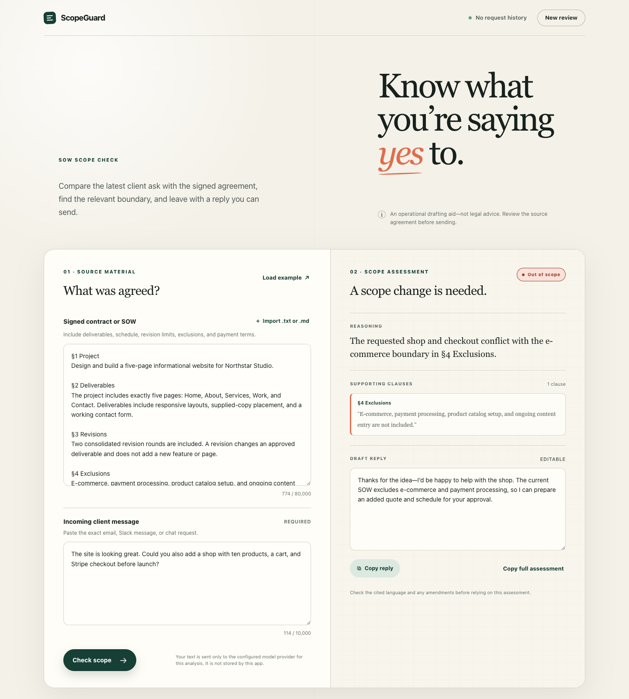

# ScopeGuard

[](https://github.com/rooshyp/scope-compliance-assistant/actions/workflows/ci.yml)

A conservative SOW scope checker and client-reply drafting assistant for freelancers and independent contractors.



Paste a signed contract or Statement of Work and the client's latest message. ScopeGuard compares the request with the supplied agreement, classifies it as `IN_SCOPE`, `OUT_OF_SCOPE`, or `AMBIGUOUS`, cites the relevant clause when needed, and drafts a professional reply.

> ScopeGuard is an operational drafting aid, not legal advice. Always review the signed agreement and cited text before relying on an assessment.

## What it does

- Applies conservative, explicit classification rules: unclear language becomes `AMBIGUOUS`.
- Evaluates mixed requests as a whole; any clearly out-of-scope material item controls the final classification.
- Uses Structured Outputs so every response follows one validated schema.
- Requires source-grounded evidence for every decision, including affirmative coverage for `IN_SCOPE`.
- Verifies each cited section label and contiguous excerpt against the supplied SOW.
- Makes one bounded correction attempt, then fails closed instead of returning an unverified answer.
- Keeps the OpenAI API key on the server and does not persist or log submitted agreements or messages.
- Provides an editable client reply plus one-click copy actions for the reply or full assessment.
- Includes plain-text `.txt` and `.md` import, responsive design, keyboard support, and reduced-motion support.

The integration follows OpenAI's official guidance for [Structured Outputs](https://developers.openai.com/api/docs/guides/structured-outputs). The default `gpt-5.4-nano` model is documented by OpenAI as optimized for classification and extraction and supports both the Responses API and Structured Outputs; it can be replaced through an environment variable. See the [official model page](https://developers.openai.com/api/docs/models/gpt-5.4-nano).

## Quick start

Requirements: Node.js 22 or later and an OpenAI API key.

```bash
git clone https://github.com/rooshyp/scope-compliance-assistant.git
cd scope-compliance-assistant
npm install
cp .env.example .env
```

Add your key to `.env`:

```dotenv
OPENAI_API_KEY=your_key_here
```

Start the development server:

```bash
npm run dev
```

Open [http://127.0.0.1:3000](http://127.0.0.1:3000). Select **Load example** to try a synthetic SOW. The same inputs are available in [`examples/`](examples/)—never use a real client's contract in a public demo.

## Output contract

The browser renders the structured result and can copy the exact requested plain-text format:

```text
CLASSIFICATION: [IN_SCOPE | OUT_OF_SCOPE | AMBIGUOUS]
REASONING: [1–2 sentences plus verified SOW citations]
DRAFT_REPLY: [short client-facing message]
```

Internally, the API includes a structured `sow_citations` array so the interface can display supporting clauses separately. Each excerpt must be exact, contiguous text inside its cited SOW section.

## Classification policy

| Classification | Rule |
| --- | --- |
| `IN_SCOPE` | Every material item is expressly covered or unambiguously necessary for a covered deliverable, with no stated limit or condition exceeded. |
| `OUT_OF_SCOPE` | At least one material item conflicts with an explicit exclusion, quantified limit, fixed condition, or clearly closed deliverables list. |
| `AMBIGUOUS` | Nothing is clearly out of scope, but the supplied text lacks a necessary fact, is broad or contradictory, or leaves the current revision/payment state unclear. |

Absence alone is not treated as `OUT_OF_SCOPE` unless the agreement clearly defines an exhaustive scope or another definite boundary. The client message is always treated as untrusted evidence, never as instructions or an automatic amendment.

## API

### `POST /api/analyze`

Accepts `application/json` only:

```json
{
  "sow": "§1 Deliverables …",
  "client_message": "Could you also add …?"
}
```

Success response:

```json
{
  "classification": "OUT_OF_SCOPE",
  "reasoning": "The additional shop conflicts with §4 Exclusions.",
  "sow_citations": [
    {
      "section": "§4 Exclusions",
      "excerpt": "E-commerce and payment processing are not included."
    }
  ],
  "draft_reply": "Thanks for the idea …",
  "formatted": "CLASSIFICATION: OUT_OF_SCOPE\nREASONING: …\nDRAFT_REPLY: …",
  "requestId": "…"
}
```

Stable error shape:

```json
{
  "error": {
    "code": "INVALID_INPUT",
    "message": "Check the highlighted fields and try again.",
    "requestId": "…"
  }
}
```

Limits are 80,000 characters for the SOW, 10,000 for the client message, and 128 KiB for the complete HTTP body. Requests are never silently truncated.

### `GET /api/health`

Returns a minimal liveness response without exposing configuration or contract data.

## Configuration

| Variable | Required | Default | Purpose |
| --- | --- | --- | --- |
| `OPENAI_API_KEY` | Yes | — | Server-side API credential. |
| `OPENAI_MODEL` | No | `gpt-5.4-nano` | Responses API model with Structured Outputs support. |
| `HOST` | No | `127.0.0.1` | Server bind address. Use `0.0.0.0` in a container. |
| `PORT` | No | `3000` | HTTP port. |

## Privacy and security

Contracts can contain confidential commercial terms and personal data. This repository therefore uses the following defaults:

- Input is held in memory only for the current request; there is no database, history, analytics, or body logging.
- OpenAI Responses requests set `store: false`, disabling Responses application-state storage. Provider abuse-monitoring retention still depends on account controls and may last up to 30 days by default; this app does **not** claim zero provider retention. See [OpenAI data controls](https://developers.openai.com/api/docs/guides/your-data).
- API keys stay in server environment variables. `.env` files are gitignored.
- SOW and client text is passed as untrusted user data in a separate message. The model receives no tools, browser, filesystem, or application secrets.
- Structured output, semantic validation, and source-quotation checks run before a decision is returned.
- Responses include a strict Content Security Policy and other browser security headers.
- The API rejects unsupported media types, excessive body sizes, invalid fields, and control characters, and applies a basic per-process rate limit.

For production, add HTTPS, authentication or network access controls, a shared edge rate limiter, and a documented provider/data-retention policy. Do not put agreement text in URLs, logs, traces, analytics, issue reports, or screenshots.

See [SECURITY.md](SECURITY.md) for vulnerability reporting and the threat-model boundaries.

## Known limitations

- ScopeGuard cannot prove that a pasted SOW is signed, complete, current, or authentic.
- It cannot know revision usage, payment receipt, verbal approvals, or later amendments unless that information is in the supplied text.
- A mechanically verified quotation can still be interpreted incorrectly. Source matching is not legal validation.
- `.txt` and `.md` import is supported; PDF and Word parsing is intentionally excluded from this version. Paste extracted text instead.
- The in-memory rate limiter is per server process. Use an edge or shared limiter for multi-instance deployments.

## Development

```bash
npm run typecheck   # strict TypeScript validation
npm test            # unit and HTTP integration tests
npm run build       # production build to dist/
npm run check       # all of the above
npm start           # run the compiled server
```

The test suite covers schema enforcement, exact output formatting, source citation verification, bounded repair, fail-closed behavior, safe error mapping, request-size boundaries, security headers, and rate limiting. GitHub Actions runs the full check on pushes and pull requests.

Project layout:

```text
src/
  analyzer.ts   OpenAI Structured Outputs call, verification, repair
  prompt.ts     conservative classification and reply policy
  schema.ts     shared Zod input/output schemas and formatter
  server.ts     HTTP API, static server, limits, headers, errors
public/
  index.html    accessible one-page interface
  styles.css    responsive visual system
  app.js        browser orchestration, import, rendering, copy flow
tests/          unit and HTTP integration tests
```

Contributions are welcome; read [CONTRIBUTING.md](CONTRIBUTING.md) first. Please use synthetic contracts and messages in every test, issue, and pull request.

## License

[MIT](LICENSE)
